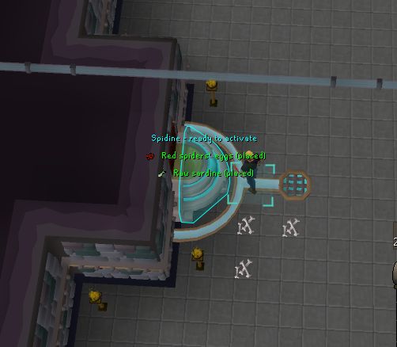
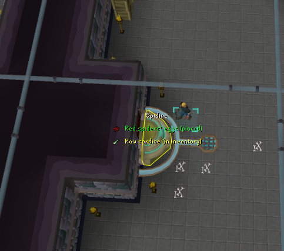
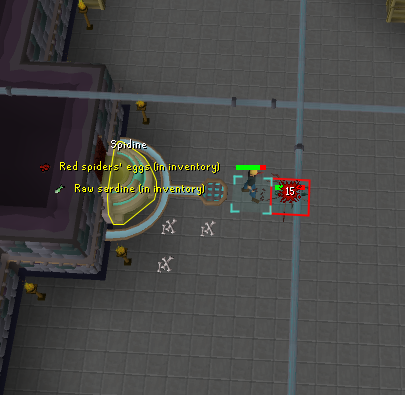
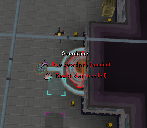

# Tower of Life

A plugin for [RuneLite](https://runelite.net), the open-source game client for *Old School RuneScape*. It is published on the RuneLite [Plugin Hub](https://runelite.net/plugin-hub/show/tower-of-life), where players can install it from inside the client.

## Background

- **Old School RuneScape** (OSRS) is a long-running online role-playing game made by Jagex.
- **RuneLite** is a free, open-source Java client for OSRS, approved for use by Jagex. It has an API for reading game state (objects, inventory, varbits, chat) and for drawing overlays on top of the game.
- **The Plugin Hub** is RuneLite's directory of community plugins. Each submission goes through review by the RuneLite team for code quality, performance, and Jagex's third-party client rules before it ships to users.

## What this plugin does

*Creature Creation* is a puzzle in the basement of the Tower of Life. There are six altars, and each one needs a specific pair of items before it can be activated. The game shows nothing to tell you which altar wants what or what has already been placed, so players usually keep a wiki page open. This plugin puts that information directly on each altar.

Each Symbol of life altar needs two items before you can activate it to create a creature. This plugin labels every altar with:

- the creature it creates
- the two items it needs, and whether each one is **placed** (green), **in your inventory** (yellow), or still **needed** (red)
- an outline around the altar: cyan when it is ready to activate, yellow when you are carrying everything it still needs, red otherwise

| Ready to activate | One placed, one carried |
|---|---|
|  |  |
| **Carrying both items** | **Nothing placed or carried** |
|  |  |

Clicking Activate while carrying both items also works: the altar takes them from your inventory and creates the creature in one step.

| Creature | Items |
|---|---|
| Newtroost | Eye of newt + Feather |
| Unicow | Unicorn horn + Cowhide |
| Spidine | Red spiders' eggs + Raw sardine |
| Swordchick | Raw swordfish + Raw chicken |
| Jubster | Raw jubbly + Raw lobster |
| Frogeel | Giant frog legs + Raw cave eel |

## How placed items are tracked

The game stores which items are on each altar in 12 varbits (`TOL_SYMBOL_OBJ1`–`12`), one per item. The plugin reads them directly, so the overlay matches the game from the moment you log in, including after a relog.

Inspecting an altar also updates the overlay from what the dialogue says, as a backup.

## Configuration

- Show creature name, required items, and item icons
- Hide items that are already placed
- Highlight altars
- Colors for placed, in inventory, missing, and ready

## Technical overview

Written in Java 11 against the RuneLite client API and built with Gradle.

- **Event-driven state:** the plugin subscribes to client events (object spawn/despawn, varbit changes, inventory changes, chat messages, menu clicks). It keeps its own model of the six altars instead of scanning the scene every frame.
- **Reading game state directly:** placed items come from the game's own varbits, so the overlay stays accurate after a relog without the player re-inspecting anything. Parsing the inspect dialogue and chat messages serves as a fallback.
- **Lightweight rendering:** the overlay runs every frame, so state is tracked in the event handlers and the per-frame work is kept small.
- **Tests:** JUnit tests cover the altar/item mapping, varbit coverage, and the dialogue and chat-message parsers.
- **Hub compliance:** no reflection, no network access, no input automation, and no menu changes that send actions to the server, in line with RuneLite's Plugin Hub rules.

### Project layout

| File | Role |
|---|---|
| `TowerOfLifePlugin.java` | Event handling and altar state |
| `TowerOfLifeOverlay.java` | Draws labels, item icons, and outlines on the altars |
| `Altar.java` | The six altars, their creatures, and required items |
| `TowerOfLifeConfig.java` | User settings shown in the RuneLite sidebar |

### Building and running locally

```bash
./gradlew build
./gradlew run   # launches a development RuneLite client with the plugin loaded
```

## License

BSD 2-Clause. See [LICENSE](LICENSE).
