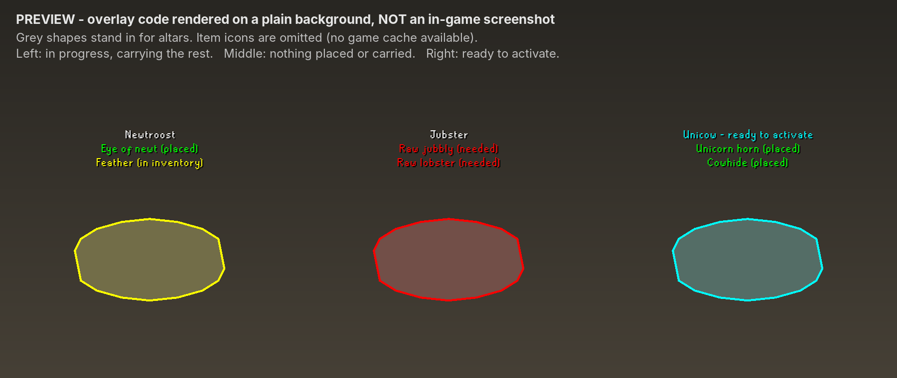

# Tower of Life

A RuneLite plugin for Creature Creation in the Tower of Life basement.

Each Symbol of life altar needs two items before you can activate it to create a creature. This plugin labels every altar with:

- the creature it creates
- the two items it needs, and whether each one is **placed** (green), **in your inventory** (yellow), or still **needed** (red)
- an outline around the altar: cyan when it is ready to activate, yellow when you are carrying everything it still needs, red otherwise

*The image above is a preview of the overlay drawing code on a plain background, not an in-game screenshot.*

| Creature | Items |
|---|---|
| Newtroost | Eye of newt + Feather |
| Unicow | Unicorn horn + Cowhide |
| Spidine | Red spiders' eggs + Raw sardine |
| Swordchick | Raw swordfish + Raw chicken |
| Jubster | Raw jubbly + Raw lobster |
| Frogeel | Giant frog legs + Raw cave eel |

## How placed items are tracked

The game stores which items are on each altar in 12 hidden flags (varbits), but the client data does not say which flag belongs to which item. The plugin:

1. Watches you use an item on an altar and the item leave your inventory, then marks it as placed. This is saved per account.
2. Clears an altar when you activate it and its creature appears.
3. Learns which flag matches an item the first time you place it. After that it reads the game's own state, so it stays accurate across restarts.

Items placed before you installed the plugin show as missing until you place or activate again.

## Configuration

- Show creature name, required items, and item icons
- Hide items that are already placed
- Highlight altars
- Colors for placed, in inventory, missing, and ready
